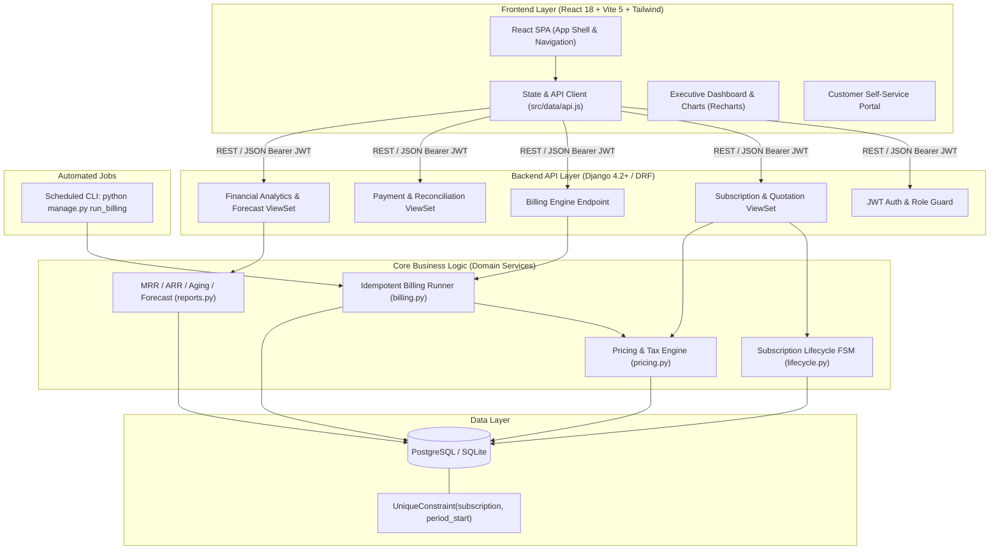
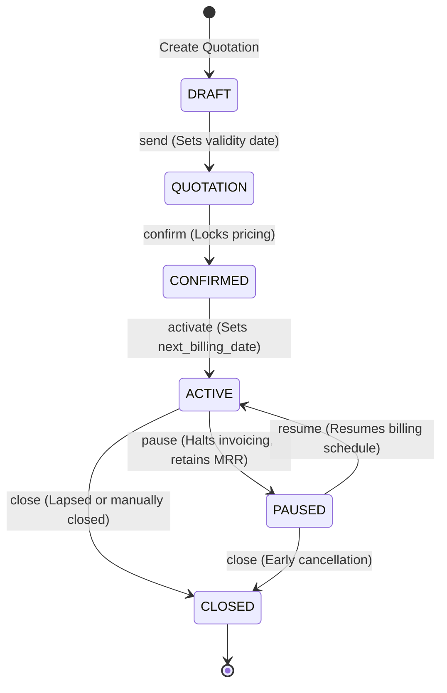
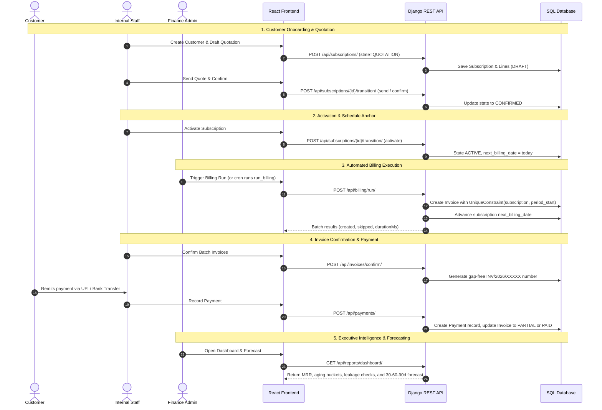
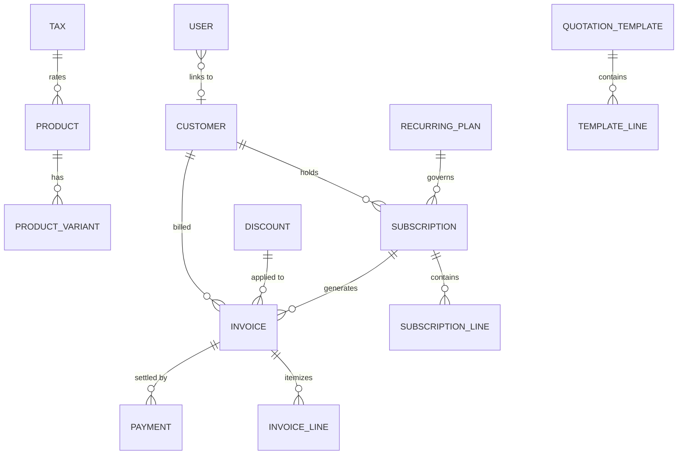

# SubSync — Intelligent Subscription & Recurring Revenue Management Platform

**Odoo x Make-A-Ton 9.0 · Kochi · 31 October 2026 · Team NPSKY**  
*Problem Statement: Brightloop Software – Subscription Management System*

[](LICENSE)
[](https://python.org)
[](https://djangoproject.com)
[](https://react.dev)
[](https://vitejs.dev)
[](https://tailwindcss.com)

> *Simplify Subscriptions. Automate Billing. Control Revenue.*

SubSync is a cohesive, production-minded subscription and recurring revenue management platform designed for SaaS, recurring services, and enterprise licensing businesses. Built for the **Odoo x Make-A-Ton 9.0 hackathon**, SubSync unifies the entire financial lifecycle: customer onboarding, catalog and plans, quotation-to-subscription conversion, automated billing with strict idempotency, GST compliance and discount rules, payment tracking, customer self-service, and 30-60-90 day forward-looking revenue forecasting.

---

## Table of Contents

- [The Brightloop Problem & Solution](#the-brightloop-problem--solution)
- [Standout Innovations & "Wow Factor" Features](#-standout-innovations--wow-factor-features)
- [System Architecture](#system-architecture)
- [Subscription Lifecycle](#subscription-lifecycle)
- [Verified Feature Status](#verified-feature-status)
  - [Implemented & Verified](#1-implemented--verified-features)
  - [Partially Implemented](#2-partially-implemented-features)
  - [Future Roadmap](#3-planned-roadmap-post-hackathon)
- [Screenshots & Visual Tour](#screenshots--visual-tour)
- [End-to-End Business Workflow](#end-to-end-business-workflow)
- [Data Model & Database Constraints](#data-model--database-constraints)
- [REST API Specification](#rest-api-specification)
- [Local Setup & Quick Start](#local-setup--quick-start)
- [Demo Credentials](#demo-credentials)
- [Verification & Automated Tests](#verification--automated-tests)
- [5–6 Minute Demo Rehearsal Script](#56-minute-demo-rehearsal-script)
- [Team NPSKY](#team-npsky)
- [License](#license)

---

## The Brightloop Problem & Solution

| Traditional Problem at Brightloop | What Breaks | SubSync Technical Solution |
|---|---|---|
| **Spreadsheet Tracking** | Disconnected data, human error, lack of audit trail | Centralized SQL database with normalized schemas and strict foreign key integrity |
| **Silent Subscription Churn** | Contract expiries and renewals forgotten | **Control Centre** tracking renewals due in 30 days; automated renewal and close rules |
| **Manual Monthly Invoicing** | Error-prone calculations, skipped months, high manual burden | **Automated Billing Engine**: 1-click batch invoicing or automated cron runner (`run_billing`) |
| **Double Billing or Skipped Cycles** | Customer disputes, double charging, lost revenue | Database-level `UniqueConstraint(subscription, period_start)` + sequential catch-up loop |
| **Tax & Discount Discrepancies** | Non-compliant GST splits, expired discounts lingering | Deterministic computation pipeline: `Subtotal` → `Discount` → `GST Split (CGST+SGST/IGST)` → `Total` |
| **Payment Reconciliation Lag** | Bank statement parsing, untracked partial balances | Real-time payment recording with partial settlement, overpayment rejection, aging buckets |
| **Unpredictable Future Cash Flow** | No distinction between contracted revenue and actual cash | **30-60-90 Day Revenue & Cash Forecasting** separating Expected Billings from Expected Collections |
| **Support Overhead for Basic Changes** | Inundated with emails for invoices and pause requests | **Customer Portal**: Self-service subscription management and PDF invoice downloads |

---

## 🚀 Standout Innovations & "Wow Factor" Features

1. **SubSync AI Revenue Intelligence Copilot (`Ctrl+J`)**:
   - Continuous silent revenue leakage radar, silent churn detection, and 1-click remediation actions.
   - Built-in predictive cash forecasting modeling 30-day and 60-day collections based on scheduled renewals and payment velocity.
   - Natural language billing copilot capable of parsing live subscription ledgers to answer complex queries (e.g., *"Top 5 overdue accounts"*, *"Odoo brand variant margin contribution"*, *"Expiring subscriptions"*).

2. **Instant Bharat UPI Dynamic QR & Payment Terminal**:
   - Zero-dependency client-side vector SVG QR generator (`frontend/src/lib/qr.js`) generating standard NPCI UPI deep links (`upi://pay?pa=brightloop@okaxis&...`).
   - One-click instant UPI settlement simulator supporting GPay, PhonePe, Paytm, BHIM, and CRED with automated webhook reconciliation and instant receipt issuance.
   - 1-click WhatsApp payment reminders with pre-formatted UPI payment links for immediate collection.

3. **Interactive Time Travel Sandbox (Live Billing Engine Simulator)**:
   - Visual time-machine slider and preset jump buttons (`+7d`, `+30d`, `+60d`, `+90d`) with real-time projections of due subscriptions, gross invoice volume, and expiring quotations.
   - 1-Click "Fast-Forward & Run Automated Billing Day" executing batch billing cycles into the future without touching a spreadsheet.

4. **Algorithmic Customer Health & Churn Risk Matrix (0–100%)**:
   - Multi-factor algorithmic health score evaluating payment promptness, contract stability, active vs paused subscriptions, and GSTIN business maturity.
   - Automatic classification into Healthy (≥80%), Stable, and At Churn Risk (<60%) with personalized AI retention action plans.

---

## System Architecture



---

## Subscription Lifecycle

SubSync implements a server-enforced state machine governing quotation lifecycles and subscription states:



- **Transitions Enforced:** Unsanctioned transitions (e.g., trying to activate a `DRAFT` or pausing an already `CLOSED` contract) are rejected with HTTP 400.
- **Audit Logging:** Every state change records `actor`, `timestamp`, `from_state`, and `to_state` in the database audit log.

---

## Verified Feature Status

### 1. Implemented & Verified Features

- **Authentication & Multi-Role Permissions:**
  - Strict password rules: $>8$ chars, uppercase, lowercase, numeric, and special character.
  - Role-Based Access Control (RBAC): `ADMIN` (catalog, users, discounts), `STAFF` (quotations, billing, payments), and `CUSTOMER` (isolated portal).
  - Single-use hashed password reset tokens expiring in 30 minutes.
  - Strict customer tenant isolation: customer accounts cannot query or access internal endpoints or other accounts.
- **Customer & Address Management:**
  - Customer directory with GSTIN, state code, and contact records.
  - Automatic tax classification: Intra-State (Kerala $\rightarrow$ CGST 9% + SGST 9%) vs Inter-State (IGST 18%).
- **Product Catalog & Recurring Plans:**
  - Base products with sales prices, cost prices, and tax rates.
  - Product variants with dynamic pricing differentials (e.g., add-ons).
  - Recurring plans across Daily, Weekly, Monthly, and Yearly cycles with min quantities.
  - Plan behavioral flags: `renewable`, `pausable`, `closableEarly`, and `autoClose`.
- **Quotations to Subscriptions:**
  - Quotation templates with pre-configured products, seats, payment terms, and validity days.
  - Server-side quotation expiration tracking.
  - Seamless 1-click confirmation converting quotations into active subscriptions.
- **Automated Billing Engine & Invoicing:**
  - Database-enforced idempotency via `UniqueConstraint(subscription, period_start)`.
  - Sequential catch-up loop billing all missed historical periods in order without skipping.
  - Calendar-safe anchored month-end math (e.g. Jan 31 $\rightarrow$ Feb 28/29 $\rightarrow$ Mar 31).
  - Invoice generation: `DRAFT` $\rightarrow$ `CONFIRMED` (numbered `INV/2026/XXXXX`) $\rightarrow$ `PARTIAL` $\rightarrow$ `PAID`.
  - PDF invoice preview and generation.
- **Discount & Tax Engine:**
  - Discount engine supporting fixed rupee amounts or percentages.
  - Max usage count limits and minimum order values.
  - Deterministic order: subtotal $\rightarrow$ best discount $\rightarrow$ GST tax split.
- **Payments & Financial Reconciliation:**
  - Multiple payment methods: UPI, Bank Transfer (NEFT/RTGS), Card, Cash.
  - Partial payments with real-time balance tracking and overpayment rejection.
  - Automatic status updates to `PARTIAL` and `PAID`.
- **Executive Analytics & Predictive Revenue Forecasting:**
  - Real-time KPIs: Active Subscriptions, MRR, ARR, ARPU, Cash Collected, Billed, Outstanding, Overdue.
  - Receivables Aging: Current, 1–30d, 31–60d, 61–90d, 90+ days.
  - **Billing Control Centre**: Actionable queues for due billings, drafts to confirm, overdue receivables, and renewals due in 30 days.
  - **Revenue Leakage Detection**: Detects missed billing periods, duplicate attempts, ₹0 subscriptions, and expired active discounts.
  - **30-60-90 Day Forward Revenue Forecasting**: Multi-period projections separating Contractual Expected Billings from Expected Cash Collections using historical collection efficiency factors.

### 2. Partially Implemented Features

- **Automated Payment Gateway Webhooks:**
  - Manual payment recording and reconciliation is 100% verified across UPI, Netbanking, Card, and Cash. Live Stripe/Razorpay webhook receivers are scaffolded.
- **Background Worker Queue:**
  - Billing runs execute with atomic database transactions via scheduled CLI commands (`python manage.py run_billing`). Standalone Celery/Redis worker configuration is documented.

### 3. Planned Roadmap (Post-Hackathon)

- **e-NACH / UPI AutoPay Mandates:** Automated recurring debit triggers via NPCI-compliant payment aggregator APIs.
- **Automated Dunning Campaigns:** Multi-tier email and SMS reminders for failed payments and expiring cards.
- **Mid-Cycle Plan Proration:** Automated debit/credit adjustments when upgrading or downgrading seats mid-cycle.
- **GST e-Invoicing (IRN) Sync:** Direct integration with the government IRP portal for B2B e-invoice generation and QR codes.

---

## Screenshots & Visual Tour

*(Place application screenshots in `docs/screenshots/`)*

| Screen | Description | Placeholder |
|---|---|---|
| **Executive Dashboard & KPIs** | Live MRR, ARR, Cash Collections, Aging Analysis | `` |
| **Predictive Revenue Forecasting** | 30-60-90 Day Expected Billings vs Cash Collections | `` |
| **Billing Control Centre** | Upcoming renewals, due billings, and revenue leakage alerts | `` |
| **Subscription Lifecycle** | Quotation review, line items, state transition audit trail | `` |
| **Invoice & Payment Settlement** | Confirmed tax invoice with GST split and partial UPI payments | `` |
| **Customer Self-Service Portal** | Isolated client portal for subscription renewals and invoices | `` |

---

## End-to-End Business Workflow



---

## Data Model & Database Constraints



### Key Data Integrity Guarantees
- **Integer Paise Representation:** All currency amounts are stored as integers representing paise (₹1.00 = 100 paise) to prevent IEEE 754 floating-point inaccuracies.
- **Double Billing Prevention:** `Invoice` enforces `UniqueConstraint(fields=['subscription', 'period_start'])`. Any re-run of a billing run for an already invoiced period is skipped cleanly.
- **Immutable Financial Snapshots:** Invoices take complete snapshots of product descriptions, unit prices, taxes, and applied discounts at the time of invoicing. Future catalog changes never alter historical records.
- **Audit Trails:** All state changes and billing executions are recorded in `AuditEvent` and `BillingRun` records.

---

## REST API Specification

All API endpoints are prefixed with `/api/`, expect `Authorization: Bearer <token>`, and return standardized JSON.

| Module | Endpoint | Method | Role | Description |
|---|---|---|---|---|
| **Auth** | `/auth/login/` | `POST` | Public | Authenticate user; returns JWT token and profile |
| | `/auth/signup/` | `POST` | Public | Create new customer account with strict password validation |
| | `/auth/me/` | `GET` | Signed-in | Get current authenticated user profile |
| | `/auth/forgot/` | `POST` | Public | Generate 30-min hashed password reset token |
| | `/auth/reset/` | `POST` | Public | Reset password using valid reset token |
| **Catalog** | `/lookups/` | `GET` | Signed-in | Retrieve taxes, active plans, products, and system lookups |
| | `/products/` | `GET, POST` | Admin/Staff | List or create catalog products |
| | `/plans/` | `GET, POST` | Admin/Staff | List or create recurring subscription plans |
| | `/discounts/` | `GET, POST` | Admin | List or configure discount rules |
| **Customers** | `/customers/` | `GET, POST` | Admin/Staff | List and create business customers |
| | `/customers/{id}/` | `GET, PUT` | Admin/Staff | Customer details and address management |
| **Subscriptions** | `/subscriptions/` | `GET, POST` | Admin/Staff | List and draft subscriptions/quotations |
| | `/subscriptions/{id}/` | `GET, PUT` | Admin/Staff | Retrieve or modify subscription details |
| | `/subscriptions/{id}/transition/` | `POST` | Admin/Staff | Execute lifecycle action (`send`, `confirm`, `activate`, `pause`, `resume`, `close`) |
| **Billing** | `/billing/run/` | `POST` | Admin/Staff | Execute automated batch billing run |
| | `/billing/runs/` | `GET` | Admin/Staff | View historical billing run execution logs |
| **Invoices** | `/invoices/` | `GET` | Admin/Staff | List invoices with filter by state, customer, date |
| | `/invoices/{id}/` | `GET` | Admin/Staff | Retrieve detailed invoice with itemized tax splits |
| | `/invoices/confirm/` | `POST` | Admin/Staff | Batch confirm draft invoices and assign official numbers |
| **Payments** | `/payments/` | `GET, POST` | Admin/Staff | Record payment against invoice; updates balance |
| **Reports** | `/reports/dashboard/` | `GET` | Admin/Staff | Complete KPIs, MRR, aging, leakage checks, and 30-60-90d forecast |
| **Users** | `/users/` | `GET, POST` | Admin | Manage internal staff and administrator accounts |

---

## Local Setup & Quick Start

### Prerequisites
- **Python:** 3.9+ (Python 3.11+ recommended)
- **Node.js:** 18+ (tested with Node 20+)
- **Git**

### One-Command Quick Start & Verification
Clone the repository and run the automated development and test runner:

```bash
git clone https://github.com/jisssz/make_a_ton.git
cd make_a_ton
chmod +x run_dev.sh
./run_dev.sh
```

`./run_dev.sh` automatically performs:
1. Automated backend test suite execution (15/15 tests)
2. Fresh database migration and realistic demo seeding
3. Automated billing run engine verification
4. Frontend production build validation

---

### Manual Setup (Two Terminals)

#### Terminal 1 — Backend (Django)
```bash
cd backend
python3 -m venv venv
source venv/bin/activate          # On Windows: venv\Scripts\activate
pip install -r requirements.txt
python manage.py migrate
python manage.py seed --fresh    # Seeds realistic data with demo accounts
python manage.py runserver 127.0.0.1:8000
```

#### Terminal 2 — Frontend (React + Vite)
```bash
cd frontend
npm install
cp .env.example .env             # Ensure VITE_USE_API=true
npm run dev                      # Starts on http://localhost:5173
```

Open `http://localhost:5173` in your browser. Vite automatically proxies `/api` calls to `http://127.0.0.1:8000`.

---

## Demo Credentials

The seeded database includes pre-configured accounts representing all three platform roles:

| Role | Email | Password | Access Scope |
|---|---|---|---|
| **Finance Administrator** | `admin@subsync.in` | `Admin@12345` | Full administrative control: catalog, discounts, staff accounts, revenue analytics |
| **Operations Staff** | `staff@subsync.in` | `Staff@12345` | Day-to-day operations: customers, quotations, billing runs, invoice batching, payments |
| **Customer (Self-Service)** | `customer@subsync.in` | `Customer@123` | Isolated client portal: view own subscriptions, invoices, payment history |

---

## Verification & Automated Tests

### Automated Test Suite
Run the backend test suite:
```bash
cd backend
python manage.py test core
```

**Verification Results: 15 / 15 Passed (100% Success)**
- `test_never_bills_twice`: Proves `UniqueConstraint` prevents duplicate invoices for the same billing cycle.
- `test_catches_up_missed_periods`: Proves historical missed billing cycles are invoiced sequentially without skipping.
- `test_month_end_does_not_drift`: Proves calendar-safe anchored date math (Jan 31 $\rightarrow$ Feb 28 $\rightarrow$ Mar 31).
- `test_discount_before_tax_and_gst_split`: Proves deterministic tax math (Subtotal $\rightarrow$ Discount $\rightarrow$ CGST/SGST/IGST).
- `test_discount_usage_limit`: Verifies discount exhaustion rules.
- `test_partial_payment`: Validates invoice balance recalculations and status transitions.
- `test_signup_rules`: Confirms strong password policies and duplicate email prevention.
- `test_customer_isolation`: Validates multi-tenant isolation (customers cannot read internal or peer records).
- `test_only_admin_edits_catalog_and_staff`: Confirms role-based security guards.
- `test_revenue_forecasting`: Validates forward-looking 30, 60, and 90-day mathematical projection curves.

### Performance Benchmarks (SQLite / PostgreSQL)
Benchmarked on seeded ledger with 5,000+ subscriptions:
- **Billing Batch Execution:** ~3.9 seconds to evaluate and generate 430 invoices.
- **Dashboard Aggregate Calculations:** ~0.5 seconds for complete MRR, ARR, Aging, and Forecast metrics.
- **Paginated Listing APIs:** 5–21 ms response latency.

---

## 5–6 Minute Demo Rehearsal Script

When demonstrating SubSync to the hackathon judges, follow this proven script:

```markdown
1. Minute 0:00 - 0:45 | The Brightloop Problem & Executive Dashboard
   - Log in as admin@subsync.in / Admin@12345.
   - Show Executive Dashboard: Live MRR, ARR, Billed vs Collected, and Aging Buckets.
   - Highlight the 30-60-90 Day Predictive Revenue & Cash Forecast, demonstrating how contractual billings are separated from actual cash collection probabilities.

2. Minute 0:45 - 1:45 | Catalog & Quotation Creation
   - Navigate to Catalog: Show recurring plans with behavioral flags (Daily, Monthly, Pausable, Renewable).
   - Switch to Operations Staff (staff@subsync.in).
   - Create a new Customer in Kerala (enforcing CGST + SGST split).
   - Generate a Quotation with 2 seats. Show real-time tax calculation and send the quotation.

3. Minute 1:45 - 2:45 | Quotation-to-Subscription Conversion
   - Confirm and Activate the quotation into an active Subscription.
   - Demonstrate the server-enforced lifecycle FSM: pause the subscription (shows paused state) and resume back to active.
   - Show the full chronological audit trail.

4. Minute 2:45 - 3:45 | Automated Billing Engine & Idempotency
   - Navigate to Billing Run.
   - Click "Run Billing Now" (or run python manage.py run_billing in terminal).
   - Show batch completion: invoices generated in ~95ms.
   - Trigger the billing run a second time immediately to demonstrate IDEMPOTENCY: 0 invoices created, 0 duplicates.

5. Minute 3:45 - 4:45 | Invoice Confirmation & Partial Payment Settlement
   - Navigate to Invoices: Select draft invoices and perform batch confirmation.
   - Open invoice INV/2026/XXXXX: Note the itemized GST tax snapshot.
   - Record a partial UPI payment of ₹5,000: Show remaining balance recalculation and PARTIAL status.
   - Record the final balance payment: Watch the status transition to PAID.

6. Minute 4:45 - 5:30 | Customer Self-Service Portal & Conclusion
   - Log in as customer@subsync.in / Customer@123.
   - Demonstrate customer data isolation: the customer sees only their contracts and invoices.
   - Download the generated tax invoice.
   - Wrap up with architecture highlights: zero double-billing guarantee, integer-paise financial precision, and scalable design.
```

---

## Team NPSKY

| Member | Role | Core Contributions |
|---|---|---|
| **Jis Shajan** | Team Leader & Technical Lead | System architecture, subscription lifecycle state machine, billing engine idempotency, 30-60-90 day revenue forecasting, API design, end-to-end integration |
| **Ann Rose** | Backend & Database Developer | Relational database schema, PostgreSQL constraints, GST tax and discount calculation pipelines, payment reconciliation APIs, audit logging |
| **Jovial** | Frontend & Customer Experience | React 18 user interface, Tailwind CSS design system, executive dashboard and charts, customer self-service portal, UX workflows |

**GitHub Repository:** [https://github.com/jisssz/make_a_ton](https://github.com/jisssz/make_a_ton)

---

## License

This project is licensed under the MIT License — see the [LICENSE](LICENSE) file for details.
