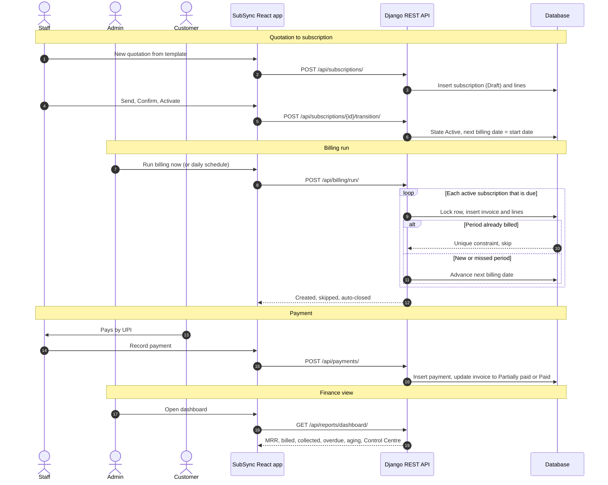
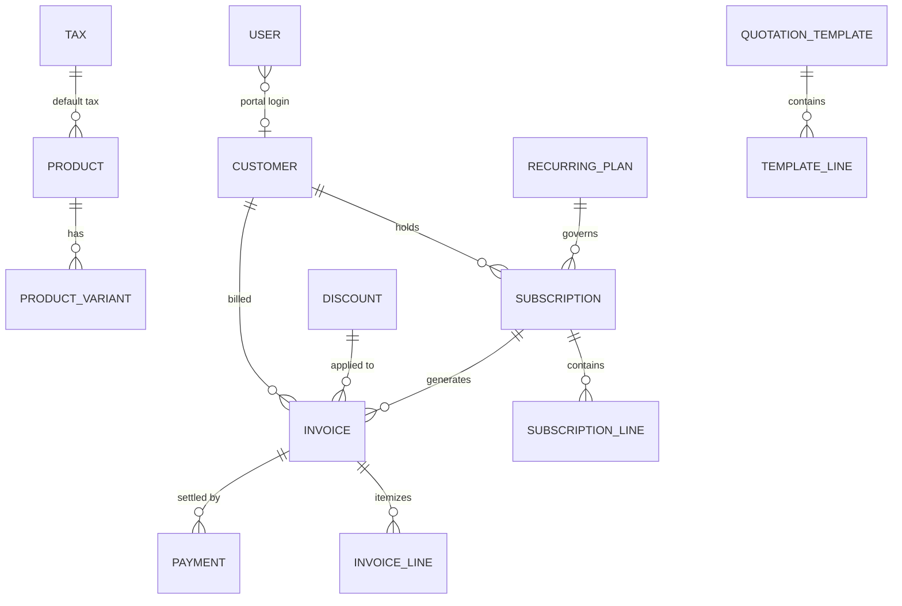

# SubSync — Subscription & Recurring Revenue Management

**Odoo x Make-A-Ton 9.0 · Kochi · 31 Oct 2026 · Team NPSKY**
Problem statement: *Brightloop Software – Subscription Management System*

SubSync is one platform that runs the whole life of a subscription business: products and plans → quotations → subscriptions → automatic invoices with GST and discounts → payments → a finance dashboard that shows what needs attention.

---

## The problem at Brightloop

| Today | What goes wrong |
|---|---|
| Subscriptions tracked in a spreadsheet | No single source of truth, typing errors |
| Renewals remembered by whoever notices | Renewals lapse silently |
| Invoices typed by hand every month | Wrong prices, taxes and discounts |
| Payments matched by scrolling bank statements | Nobody knows what is outstanding or overdue |
| Revenue reports built at quarter end | No idea of real recurring revenue (MRR) |

## How SubSync solves it

| Pain | SubSync feature |
|---|---|
| Spreadsheet tracking | Central database: customers, plans, subscriptions, invoices, payments |
| Missed renewals | Control Centre queue of renewals due in 30 days; plan-level auto-close and renew rules |
| Invoices typed by hand | **Billing run**: one click (or a daily scheduled command) invoices every due subscription |
| Billed twice or skipped | Database rule `UNIQUE(subscription, period_start)` + catch-up loop for missed periods |
| Wrong taxes / discounts | Fixed calculation order: subtotal → best discount → GST (CGST + SGST or IGST) → total |
| Payments matched by hand | Payments recorded against invoices; partial payments; live balance, overdue and aging |
| No revenue visibility | Dashboard separating **MRR/ARR**, **billed**, **cash collected**, **outstanding** and **overdue** |
| Customers emailing for everything | Customer portal: own subscriptions and invoices; pause / close / renew when the plan allows |

---

## Features (all implemented)

**Sign up & roles**
- One account per email; password must be **more than 8 characters with an uppercase letter, a lowercase letter and a special character**.
- Forgot password → single-use reset link emailed to the registered address (expires in 30 minutes, token stored hashed).
- Three roles: **Admin** (everything), **Internal staff** (day-to-day: customers, quotations, subscriptions, invoices, payments), **Customer** (own records only). Only an admin can add staff.

**Products & plans**
- Products: name, type, sales price, cost price, notes, tax; **variants** with extra price (e.g. *Brand: Odoo +₹560*).
- Recurring plans: price per seat, billing every **day / week / month / year**, minimum quantity, available-from/until dates, and per-plan rules: auto-close, closable early, pausable, renewable.

**Quotations → subscriptions**
- Quotation templates with plan, product lines, seats, payment terms and **validity days**.
- Subscription: own number (`SUB-00001`), customer, plan, start and expiry dates, payment terms, lines (product, quantity, unit price, tax, amount).
- Lifecycle **Draft → Quotation → Confirmed → Active (→ Paused) → Closed**, enforced on the server, with a timeline of who did what.

**Billing day**
- Billing run creates every due invoice with customer details, lines, discount, GST and totals already filled in.
- Running it again creates **0** invoices; missed periods are caught up in date order.
- Invoices: **Draft → Confirmed (numbered `INV/2026/00001`) → Partially paid → Paid**, or Cancelled. Confirm, cancel, **send by email**, and **print / save as PDF**.

**Discounts** (admin only)
- Fixed amount or percentage, minimum purchase or quantity, start and end dates, usage limit, for a specific product or the whole subscription.
- Applied automatically on the next invoice (best eligible one, before tax); stops when expired or used up.

**Payments**
- Method (UPI, bank transfer, card, cash), amount, date and note against an invoice; partial payments; over-payment rejected.

**Finance view**
- KPIs: active subscriptions, MRR, ARR, ARPU, cash collected, outstanding, overdue; filters by date range and plan.
- MRR trend, billed vs collected, receivables aging (current, 1–30, 31–60, 61–90, 90+).
- **Billing Control Centre**: subscriptions due, drafts to confirm, overdue invoices, renewals due, expiring quotations and discounts.
- **Revenue leakage check**: missed billing, duplicate periods, ₹0 subscriptions, expired discounts still on, invoices >60 days overdue.

### What makes SubSync different

| Feature | Why it matters |
|---|---|
| **Billing preview (dry run)** | See exactly which subscriptions will be invoiced, how many catch-up periods, and the total incl. GST — *before* pressing Run. Nothing is written. |
| **Subscription health score** | Every active subscription gets a 0–100 score with plain-language reasons (overdue invoices, days late, paused, renewal due). Dashboard ranks the riskiest and shows **MRR at risk**. Rule-based, so every point is explainable. |
| **90-day billing forecast** | Projects what the billing engine will invoice in each of the next three months from real schedules. |
| **Payment reminders** | "Send reminder" on any unpaid invoice, or **Remind all overdue** — one email per customer listing all their overdue invoices. Each reminder is logged on the invoice. |
| **UPI scan-to-pay QR** | Every unpaid invoice (staff view, customer portal and printout) shows a UPI QR with the amount and invoice number pre-filled — works with GPay, PhonePe, Paytm, BHIM. |
| **Month-over-month deltas** | MRR and cash-collected KPIs show ▲/▼ change vs last month. |
| **CSV export** | Subscriptions, invoices, payments and customers export with the current filters (up to 5,000 rows) for finance teams. |

---

## Tech stack

| Layer | Technology |
|---|---|
| Frontend | React 18, Vite 5, Tailwind CSS 3 (design tokens: Inter + Kalam, plum `#714B67`), React Router, Recharts, Lucide icons |
| Backend | Python 3.11+, Django 5, Django REST Framework, SimpleJWT |
| Database | SQLite locally (zero setup); PostgreSQL by setting `POSTGRES_*` environment variables |
| Scheduling | `python manage.py run_billing` — run daily with cron / Windows Task Scheduler |
| Email | Console in development; any SMTP server via `EMAIL_HOST` settings |

**Architecture:** a modular monolith — one Django app (`core`) split into `services/` (business rules) and `views/` (REST endpoints), and a React SPA that talks to it only through `src/data/api.js`.

---

## Workflow



## Data model



| Table | Key integrity rules |
|---|---|
| `User` | unique email; role ADMIN / STAFF / CUSTOMER; optional link to a customer |
| `Subscription` | unique number; index on (state, next_billing_date), customer, expiry |
| `Invoice` | unique number; **UNIQUE(subscription, period_start)**; index on (state, due_date) |
| `InvoiceLine` | snapshot of description, qty, price, discount, tax rate and GST split |
| `Payment` | linked to invoice; invoice `amount_paid` updated in the same transaction |
| `Sequence` | gap-free counters for SUB and INV numbers |
| `AuditEvent`, `BillingRun` | who did what and when; every billing run logged |

---

## API

All endpoints are under `/api/`, use `Authorization: Bearer <token>`, and return errors as `{"detail": "...", "fields": {...}}`.

| Area | Endpoint | Who |
|---|---|---|
| Auth | `POST auth/signup/` · `POST auth/login/` · `GET auth/me/` · `POST auth/forgot/` · `POST auth/reset/` | Public / signed in |
| Reference data | `GET lookups/` | Signed in |
| Dashboard | `GET reports/dashboard/?from=&to=&planId=` | Admin, Staff |
| Customers | `GET, POST customers/` · `GET, PUT customers/{id}/` | Admin, Staff |
| Catalog | `POST, PUT products/ plans/ taxes/ discounts/` · `PUT products/{id}/variants/` | Admin |
| Templates | `POST, PUT templates/` · `GET templates/{id}/draft/` | Admin, Staff |
| Subscriptions | `GET, POST subscriptions/` · `GET, PUT subscriptions/{id}/` · `POST subscriptions/{id}/transition/ {action}` | Staff (customers: own, pause/resume/renew/close if allowed) |
| Invoices | `GET invoices/` · `GET invoices/{id}/` · `POST invoices/confirm/` · `POST invoices/{id}/cancel/` · `POST invoices/{id}/send/` · `POST invoices/{id}/remind/` · `POST invoices/remind-overdue/` | Staff (customers: own, read-only) |
| Payments | `GET, POST payments/` | Admin, Staff |
| Billing | `POST billing/run/` · `GET billing/runs/` · `GET billing/preview/` (dry run) | Admin, Staff |
| Users | `GET, POST users/` · `POST users/{id}/toggle/` | Admin |

Customers asking for another customer's record get **404** — the API does not reveal that it exists.

---

## Setup

**Prerequisites:** Python 3.11+, Node.js 18+, Git.

**Backend** (terminal 1)
```bash
cd backend
python -m venv .venv
.venv\Scripts\activate            # macOS/Linux: source .venv/bin/activate
pip install -r requirements.txt
python manage.py migrate
python manage.py seed             # demo data (add --subs 5000 for the speed test)
python manage.py runserver        # http://127.0.0.1:8000
```

**Frontend** (terminal 2)
```bash
cd frontend
npm install
copy .env.example .env            # macOS/Linux: cp .env.example .env
# in .env set VITE_USE_API=true to use the Django backend
npm run dev                       # http://localhost:5173  (Vite forwards /api to :8000)
```

With `VITE_USE_API=false` the frontend runs alone on built-in sample data that follows the same rules — a safe fallback for demos.

**Demo logins** (after `seed`)

| Role | Email | Password |
|---|---|---|
| Admin | admin@subsync.in | Admin@12345 |
| Staff | staff@subsync.in | Staff@12345 |
| Customer | customer@subsync.in | Customer@123 |

Django admin: `http://127.0.0.1:8000/admin/` (admin login).

**Optional environment variables (backend)**

| Variable | Purpose |
|---|---|
| `DJANGO_SECRET_KEY`, `DJANGO_DEBUG`, `DJANGO_ALLOWED_HOSTS` | Production settings |
| `POSTGRES_DB`, `POSTGRES_USER`, `POSTGRES_PASSWORD`, `POSTGRES_HOST`, `POSTGRES_PORT` | Use PostgreSQL instead of SQLite (`pip install "psycopg[binary]"`) |
| `EMAIL_HOST`, `EMAIL_PORT`, `EMAIL_HOST_USER`, `EMAIL_HOST_PASSWORD` | Send real emails (reset links, invoices) |
| `FRONTEND_URL` | Base URL used in email links |
| `COMPANY_UPI` | UPI ID shown in the scan-to-pay QR on invoices (default `brightloop@upi`, a placeholder) |

## Commands

```bash
python manage.py run_billing                    # bill everything due today (schedule daily, e.g. 06:00 IST)
python manage.py run_billing --date 2027-01-31  # bill up to a given date
python manage.py seed --fresh                   # reload demo data
python manage.py test core                      # automated tests
```

---

## Correctness, security and performance

- **No double billing** — `UniqueConstraint(subscription, period_start)` in the database; each invoice, its lines, discount usage and the next billing date are written in one transaction. On PostgreSQL the subscription row is locked with `SELECT … FOR UPDATE SKIP LOCKED`, so two billing workers never process the same subscription.
- **No skipped periods** — catch-up loop; month-end safe dates (Jan 31 → Feb 28/29 → Mar 31).
- **Money** — integer paise and `Decimal` rounding (half-up); discount before tax; one best discount per invoice.
- **History is never rewritten** — invoice lines are snapshots; invoices are cancelled, not deleted; numbers are gap-free.
- **Security** — hashed passwords (Django PBKDF2), password rules enforced on both client and server, hashed single-use reset tokens, JWT, login throttling, role checks and customer isolation in every query.
- **Speed** — indexed queries, server-side pagination (25 rows), dashboard built from aggregate SQL queries, large ID lists processed in batches.

| Measured with `seed --subs 5000` (5,006 subscriptions · 55,126 invoices · 51,699 payments, SQLite) | Time |
|---|---|
| Dashboard (all KPIs, charts, Control Centre, leakage, health, forecast) | ~0.8 s |
| Subscriptions / invoices / payments lists, search and filters | 5–21 ms |
| Customers list with MRR and balances | ~40 ms |
| Subscription or invoice detail | 6–18 ms |
| Billing run creating 430 invoices | ~3.9 s (an action, not a page) |
| Confirm all 737 draft invoices | ~0.5 s |

### Verified

`python manage.py test core` covers: no double billing, catch-up billing, month-end dates, discount-before-tax and GST split, discount usage limits, partial payments, signup rules, customer isolation, admin-only actions, reset email and invoice email.

A scripted check of every requirement in the problem statement (sign-up rules, roles, products/variants, plans, quotation validity, lifecycle, billing, invoices, discounts, payments, dashboard filters, pause/resume/renew/auto-close, customer portal) passes against the seeded backend.

---

## Project layout

```
backend/
  subsync/settings.py          settings (SQLite / PostgreSQL, JWT, email, company GSTIN)
  core/models.py               data model
  core/services/pricing.py     discount → GST → totals
  core/services/billing.py     billing engine, invoices, payments
  core/services/lifecycle.py   subscription states and actions
  core/services/reports.py     dashboard, Control Centre, leakage checks
  core/views/                  REST endpoints: auth, catalog, subscriptions, billing
  core/management/commands/    seed, run_billing
  core/tests.py
frontend/
  src/data/api.js              single data layer (REST, or built-in demo store)
  src/data/store.js            demo store with the same business rules
  src/pages/                   landing, auth, app/*, portal/*
  src/components/              app shell, UI kit, shared tables and payment dialog
```

## Roadmap (after the hackathon)

Health-score tuning from real churn data · payment gateway with UPI AutoPay / e-mandates (24-hour pre-debit notice) and webhook de-duplication · dunning retries · proration for mid-cycle plan changes · credit notes · server-generated PDF invoices · GST e-invoicing (IRN) · Celery workers for large billing batches · Argon2 password hashing · TypeScript.

---

## Team NPSKY

| Member | Role | Responsibilities |
|---|---|---|
| Jis Shajan | Team Leader & Technical Lead | Architecture, subscription lifecycle, billing engine, API design, final integration |
| Ann Rose | Backend & Database Developer | Schema and constraints, GST and discount calculations, payment APIs, audit trail |
| Jovial | Frontend & Customer Experience | React UI, Tailwind design system, dashboard charts, customer portal, end-to-end flows |

Repository: https://github.com/jisssz/make_a_ton
